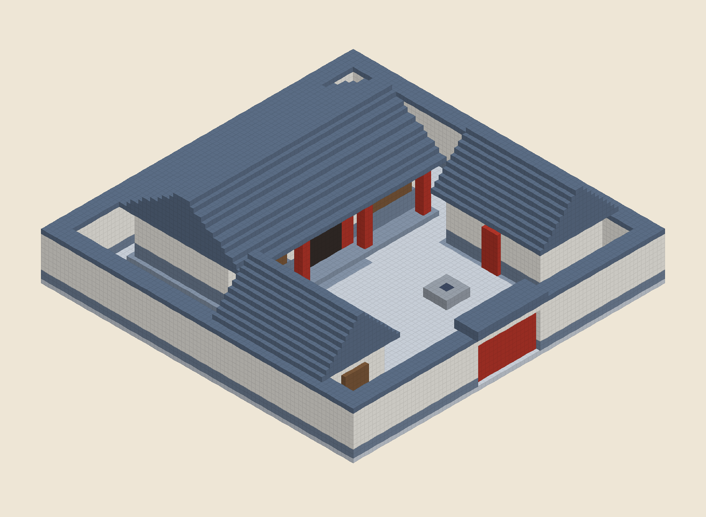
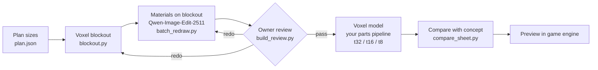

# ai-voxel-buildings

English | [简体中文](README.zh-CN.md)

A method — and the scripts behind it — for making buildings for a voxel game with an image-edit model in the loop:
**plan sizes → isometric voxel blockout → Qwen-Image-Edit-2511 puts materials on the blockout → owner review → voxel model built from the approved concept → preview in the game engine.**

It is written as an [Agent Skill](SKILL.md): any AI coding agent that can run commands and look at images can follow
`SKILL.md` step by step, and so can a person.



## Pipeline



## Why a blockout first

The first attempt used plain text-to-image prompts. It failed in three ways:

1. **Proportions were wrong.** Doors, windows and steps came out too big and bays too few — a planned 20 m, five-bay hall became three bays and 8 m wide. Long buildings were squashed by the square canvas.
2. **Layouts were wrong.** Describing a compound in words never put the buildings, walls and openings in the right place: gardens moved, partition walls cut off rooms, gates vanished.
3. **The angle was wrong.** A wide canvas fixed the bay count but turned the view into a flat front elevation.

A voxel blockout drawn from the planned sizes locks proportion, layout and camera at once. The edit model only
swaps materials and adds detail. At redraw strength 1.0 (single building) or 0.85 (whole compound) the structure
survives almost unchanged.

## Quick start

### 1. Python

```bash
pip install numpy pillow        # psutil is optional (RAM stats in batch logs)
```

### 2. Run the example blockouts (no GPU needed)

```bash
git clone https://github.com/Xinshuer/ai-voxel-buildings.git
cd ai-voxel-buildings
python scripts/blockout.py plan --plan examples/plan.json --type hall_court --tier standard --part hall --out work/hall-single.png
python scripts/blockout.py plan --plan examples/plan.json --type hall_court --tier standard --out work/hall-court.png
python scripts/blockout.py shape pagoda --out work/pagoda.png
```

The expected results are in [`examples/blockouts/`](examples/blockouts/).

### 3. ComfyUI and models

Install [ComfyUI](https://github.com/comfyanonymous/ComfyUI) and put these files (ComfyUI's repackaged Qwen-Image
releases on Hugging Face) into its model folders. The names are constants at the top of `scripts/comfy.py`; change them if yours differ.

| folder | file | used for |
|---|---|---|
| `models/diffusion_models` | `qwen_image_edit_2511_fp8mixed.safetensors` | redraw (required) |
| `models/diffusion_models` | `qwen_image_2512_fp8_e4m3fn.safetensors` | text-to-image (optional) |
| `models/text_encoders` | `qwen_2.5_vl_7b_fp8_scaled.safetensors` | both |
| `models/vae` | `qwen_image_vae.safetensors` | both |

Start a dedicated instance on its own port (so you don't disturb one already on 8188):

```bash
python main.py --listen 127.0.0.1 --port 8189 --disable-pinned-memory --cache-none
```

- **Do not add `--highvram`** — on a 16 GB card Qwen fills VRAM and runs more than ten times slower.
- The t2i and edit models are about 20 GB each. Pass `--free` to the scripts when switching, so both are never loaded together.
- An edit at 40 steps takes roughly 3.5–7 minutes on a 16 GB card. On long batches watch for GPU driver timeouts (Windows: `nvlddmkm` event 153).

### 4. Redraw the example

```bash
python scripts/batch_redraw.py --prompts examples/redraw_prompts.json --out work/concepts
python scripts/build_review.py --prompts examples/redraw_prompts.json --images work/concepts --out work/review.html --show-blockout
```

Use `--url` or the `COMFY_URL` environment variable for another address. Try settings on one image first:

```bash
python scripts/edit_from_blockout.py --prompts examples/redraw_prompts.json --id example_hall 40 40@0.85
```

### 5. Model and preview

Building the VOX model is up to **your own voxel parts pipeline**; [`references/modeling.md`](references/modeling.md)
lists what it must do (three tiers, ≤ 8 m modules on whole metres, constructive texture, comparison with the concept,
connectivity check) and how to preview in an engine editor.

## Prompts file

`batch_redraw.py`, `edit_from_blockout.py` and `build_review.py` read a JSON list. One entry per image:

| field | required | meaning |
|---|---|---|
| `id` | yes | unique; output is `<out>/<category>/<id>.png` |
| `blockout` | yes | blockout PNG, relative to the prompts file (or `--root`) |
| `prompt` | yes | positive prompt (structure: lock the blockout → construction → colour legend → palette → prohibitions) |
| `neg` | no | negative prompt (default: generic quality negatives) |
| `strength` | no | redraw strength = denoise; 1.0 single building, 0.85 compound (default 1.0) |
| `seed` | no | default 0 |
| `category` | no | sub-folder and review-page section |
| `name`, `size`, `notes` | no | shown on the review page |

The example prompts are in Chinese, the language these settings were measured in. Note the rule: never write
「粉」 in a Chinese prompt — Qwen reads 「白灰粉墙」 (whitewashed wall) as pink; put pink in the negative prompt.

## Layout

```
ai-voxel-buildings/
├── SKILL.md                    the method, step by step (start here)
├── references/
│   ├── rules.md                recommended rules and example palette
│   ├── blockout-and-redraw.md  blockout details, measured redraw settings, ComfyUI pitfalls
│   ├── review.md               review rounds and the review log
│   └── modeling.md             requirements for your voxel pipeline, checks, engine preview
├── docs/
│   └── plan-format.md          the plan JSON read by blockout.py
├── scripts/
│   ├── blockout.py             isometric voxel blockouts
│   ├── comfy.py                ComfyUI client and Qwen workflows
│   ├── edit_from_blockout.py   redraw one blockout (tests)
│   ├── batch_redraw.py         resumable batch redraw
│   ├── compare_sheet.py        side-by-side comparison sheet
│   └── build_review.py         HTML review page
└── examples/
    ├── plan.json               a walled courtyard with a three-bay overhanging-gable hall
    ├── redraw_prompts.json     prompts for the two example blockouts
    └── blockouts/              hall-single.png, hall-court.png
```

## Recommended rules (summary)

Defaults from production use — adapt them to your project ([full list](references/rules.md)):

- No people, vegetation, compound walls or loose props in concept images or building models; those are separate assets.
- Compounds keep their doors; run a connectivity check from the main gate after modelling.
- Everything structural on a whole-metre grid; walls are exactly one cell thick.
- Eaves may overhang the walls (above eave height only); two-storey buildings use a pent eave instead of a projecting balcony.
- One shared palette per settlement; never write 「粉」 in a Chinese prompt.
- One heavy job at a time (generation, modelling, engine editor); ask before starting one.
- One decision per question, with a recommended option; report scores and failed checks honestly.

## Licence

The code and documents in this repository are under the [MIT License](LICENSE).

**Model licences — check before you ship anything:**

- **Qwen-Image-2512** and **Qwen-Image-Edit-2511** are released under **Apache-2.0**. Images you make with them can be used commercially, subject to that licence.
- **Qwen-Image-2.1** is licensed for **research only**. Images made with it **must not be used commercially** — treat them as placeholders and redo them with an Apache-2.0 model before release.
- Speed-up LoRAs and any other model you add have their own licences.
