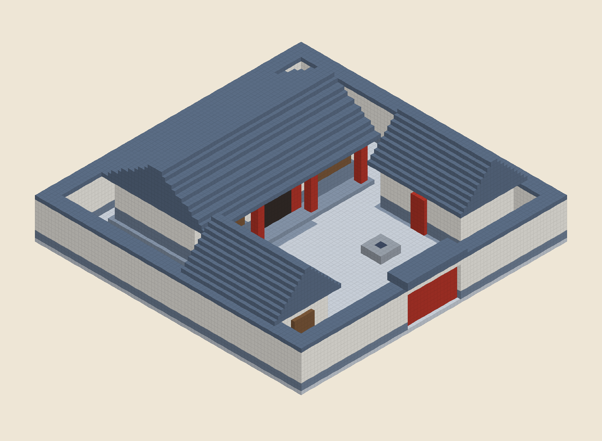
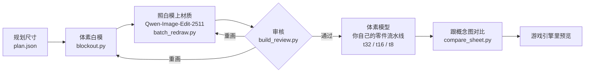

# ai-voxel-buildings

[English](README.md) | 简体中文

给体素游戏做建筑的一套做法和配套脚本，中间用图像编辑模型出概念图：
**定规划尺寸 → 画等轴测体素白模 → 用 Qwen-Image-Edit-2511 照白模上材质 → 审核 → 照通过的概念图做体素模型 → 装进游戏引擎预览。**

整套写成一个 [Agent Skill](SKILL.md)：会跑命令、会看图的 AI 编程代理可以照着 `SKILL.md` 一步步做，人也可以。



## 流程



## 为什么先做白模

第一轮直接用文字出图，出了三个问题：

1. **比例不对。** 门、窗、台阶画大了，开间画少了。规划里 20 米宽、五开间的厅堂，画出来三开间、8 米宽。长条的房子被方形画幅压短。
2. **布局不对。** 用文字写整组院落，房子、院墙、门洞总摆不对：花园跑到前面，隔墙把厢房切断，大门没了。
3. **角度不对。** 换成横长画幅，开间数对了，画面却变成了正立面平视。

先按规划尺寸画体素白模，比例、布局、镜头一起锁住，编辑模型只负责换材质、加细节。单栋用上色强度 1.0、整组用 0.85，结构基本不变。

## 快速开始

### 1. Python

```bash
pip install numpy pillow        # psutil 可选（批量日志里记内存）
```

### 2. 跑例子白模（不需要显卡）

```bash
git clone https://github.com/Xinshuer/ai-voxel-buildings.git
cd ai-voxel-buildings
python scripts/blockout.py plan --plan examples/plan.json --type hall_court --tier standard --part hall --out work/hall-single.png
python scripts/blockout.py plan --plan examples/plan.json --type hall_court --tier standard --out work/hall-court.png
python scripts/blockout.py shape pagoda --out work/pagoda.png
```

应该得到的图在 [`examples/blockouts/`](examples/blockouts/)。

### 3. ComfyUI 和模型

装好 [ComfyUI](https://github.com/comfyanonymous/ComfyUI)，把下面几个文件（ComfyUI 在 Hugging Face 上重新打包的 Qwen-Image）放进对应文件夹。文件名是 `scripts/comfy.py` 开头的常量，跟你的不一样就改那里。

| 文件夹 | 文件 | 用途 |
|---|---|---|
| `models/diffusion_models` | `qwen_image_edit_2511_fp8mixed.safetensors` | 上材质（必需） |
| `models/diffusion_models` | `qwen_image_2512_fp8_e4m3fn.safetensors` | 文字出图（可选） |
| `models/text_encoders` | `qwen_2.5_vl_7b_fp8_scaled.safetensors` | 两者都用 |
| `models/vae` | `qwen_image_vae.safetensors` | 两者都用 |

单独起一个实例、用自己的端口，免得打扰已经在 8188 上跑的那个：

```bash
python main.py --listen 127.0.0.1 --port 8189 --disable-pinned-memory --cache-none
```

- **不要加 `--highvram`**：16 GB 显卡上 Qwen 会塞满显存，慢十几倍。
- 出图模型和编辑模型各约 20 GB。换模型时给脚本加 `--free`，先卸掉上一个，别让两个同时占内存。
- 16 GB 显卡上编辑 40 步一张约 3.5 到 7 分钟。跑长批要留意显卡驱动超时（Windows 事件 `nvlddmkm` 153）。

### 4. 给例子上材质

```bash
python scripts/batch_redraw.py --prompts examples/redraw_prompts.json --out work/concepts
python scripts/build_review.py --prompts examples/redraw_prompts.json --images work/concepts --out work/review.html --show-blockout
```

别的地址用 `--url` 或环境变量 `COMFY_URL`。先拿一张试参数：

```bash
python scripts/edit_from_blockout.py --prompts examples/redraw_prompts.json --id example_hall 40 40@0.85
```

### 5. 建模和预览

做 VOX 模型要**接你自己的体素零件流水线**。[`references/modeling.md`](references/modeling.md) 写了它要满足的要求（三档、模块不超过 8 米且对齐整米、构造性纹理、跟概念图对图、连通检查），以及怎么在引擎编辑器里预览。

## 提示词文件

`batch_redraw.py`、`edit_from_blockout.py`、`build_review.py` 读一个 JSON 列表，每张图一条：

| 字段 | 必需 | 含义 |
|---|---|---|
| `id` | 是 | 唯一；输出到 `<out>/<category>/<id>.png` |
| `blockout` | 是 | 白模 PNG，相对提示词文件所在目录（或 `--root`） |
| `prompt` | 是 | 正向提示词（顺序：锁住白模 → 构造 → 白模颜色对照 → 配色 → 禁令） |
| `neg` | 否 | 反向提示词（默认是通用的画质反向词） |
| `strength` | 否 | 上色强度，即 denoise；单栋 1.0，整组 0.85（默认 1.0） |
| `seed` | 否 | 默认 0 |
| `category` | 否 | 子文件夹，也是审核页的分组 |
| `name`、`size`、`notes` | 否 | 显示在审核页上 |

例子里的提示词是中文，上面的参数都是用中文提示词实测的。注意：中文提示词里**不要出现「粉」字**，Qwen 会把「白灰粉墙」读成粉红色；粉色放进反向提示词。

## 目录

```
ai-voxel-buildings/
├── SKILL.md                    做法，一步一步（从这里看起）
├── references/
│   ├── rules.md                推荐规矩和示例色板
│   ├── blockout-and-redraw.md  白模细节、上色实测参数、ComfyUI 的坑
│   ├── review.md               审核轮次和审核记录
│   └── modeling.md             体素流水线要满足的要求、检查、引擎预览
├── docs/
│   └── plan-format.md          blockout.py 读的规划 JSON
├── scripts/
│   ├── blockout.py             等轴测体素白模
│   ├── comfy.py                ComfyUI 客户端和 Qwen 工作流
│   ├── edit_from_blockout.py   单张上色（试参数）
│   ├── batch_redraw.py         可中断、可重跑的批量上色
│   ├── compare_sheet.py        并排对比图
│   └── build_review.py         审核网页
└── examples/
    ├── plan.json               带院墙的三开间悬山厅堂院落
    ├── redraw_prompts.json     两张例子白模的上色提示词
    └── blockouts/              hall-single.png、hall-court.png
```

## 推荐规矩（摘要）

实际生产里定下来的默认做法，按你的项目改（[完整列表](references/rules.md)）：

- 概念图和建筑模型里不画人、植被、院墙、散放道具，这些都是单独的素材。
- 整组建筑留门；建模后从大门做连通检查。
- 结构一律落在整米格上；墙一律占整一格宽。
- 屋檐可以伸出墙外（只在檐口高度以上）；两层楼不往外挑廊，用腰檐。
- 一座城用一套配色；中文提示词别用「粉」。
- 重活一次只跑一样（出图、建模、引擎编辑器），开之前先问。
- 一次只问一个问题，带推荐项；分数和没过的检查照实说。

## 许可

本仓库的代码和文档用 [MIT 许可](LICENSE)。

**模型许可，发布前一定要看：**

- **Qwen-Image-2512** 和 **Qwen-Image-Edit-2511** 是 **Apache-2.0** 许可，用它们出的图可以商用（遵守该许可）。
- **Qwen-Image-2.1** 的许可**只允许研究**，用它出的图**不能商用**，只能当占位图，发布前要用 Apache-2.0 的模型重做。
- 加速 LoRA 和你另外加的模型各有各的许可。
